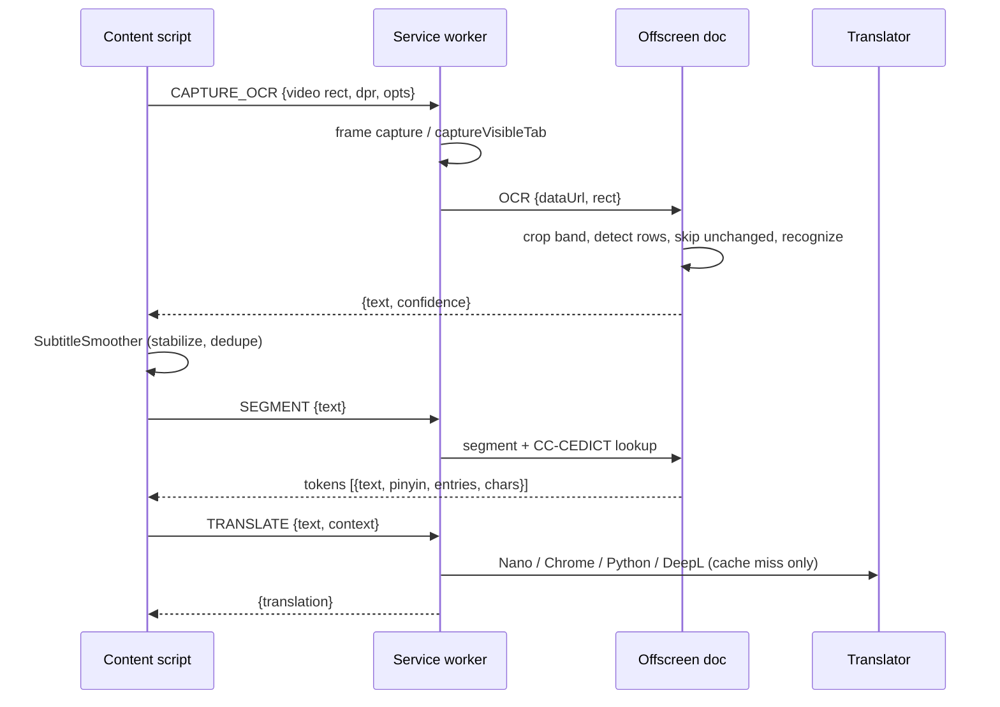

# Hanzi Subs Reactor

A Chrome extension (Manifest V3) that reads **burned-in Chinese subtitles** from any HTML5 `<video>` with OCR, translates each line (on-device model, local Python bridge or DeepL) and shows a Language Reactor-style overlay: segmented words, Pinyin and a hover dictionary (CC-CEDICT) with a per-character breakdown.

- [Installation](#installation)
- [Translators](#translators)
- [OCR engines](#ocr-engines)
- [Subtitle pipeline](#subtitle-pipeline)
- [Context for translation](#context-for-translation)
- [Settings](#settings)
- [Side panel and logs](#side-panel-and-logs)
- [Architecture](#architecture)
- [Development](#development)
- [Known limitations](#known-limitations) · [Roadmap](#roadmap)

## Installation

1. Open `chrome://extensions`, enable **Developer mode**, click **Load unpacked** and select the `extension/` folder.
2. The options page opens. Pick a translator and click **Prepare model** or **Test translation**.
3. Play a video with hardcoded Chinese subtitles. Hover a word to see its dictionary card.

Runtime assets (`extension/vendor/`, `extension/data/cedict.json`) are committed, so a fresh clone works without a build step. Manifest V3 forbids loading remote JS/WASM, so ONNX Runtime, Tesseract and Transformers.js must ship inside the extension.

To regenerate or upgrade them (Node 18+):

```bash
npm install
npm run setup                        # Tesseract, PaddleOCR v4 + ONNX Runtime WebGPU, Transformers.js, CC-CEDICT
npm run setup -- --model=best        # optional: more accurate, larger, slower Tesseract models
npm run setup -- --only=paddle       # or ocr | mt | dict
```

Optional HSK levels: add `extension/data/hsk.json` as `{ "爱": 1, "爱好": 2, ... }` (simplified word → level). It is loaded automatically.

## Translators

| Translator | Runs | Setup | Targets |
|---|---|---|---|
| **Gemini Nano** (default) | On-device LLM via Chrome's Prompt API (`LanguageModel`) | Chrome 138+, GPU >4 GB VRAM or 16 GB RAM, ~22 GB free disk; click **Prepare model** once (~2 GB). Until ready, lines fall back to Chrome built-in (uncached) | Best in English, Spanish, Japanese |
| **Chrome built-in** | On-device `Translator` API | Chrome 138+; **Prepare model** downloads the language pack | Most languages |
| **Python local bridge** | Companion app: Qwen3-VL-2B via llama.cpp (CUDA) | Run the companion app, select it for OCR and translator, paste its token | English only |
| **DeepL** | Cloud API | API key (Free keys end in `:fx`) | DeepL languages |

- Translations are cached in `chrome.storage.local` per translator, target language, context and prompt version.
- Opus-MT and Ollama are no longer offered; a saved selection is switched to Gemini Nano with a notice.
- Chrome built-in and DeepL are literal machine translators. The LLMs (Nano, Python Qwen) share a prompt (`shared/dialogue-prompt.js`) asking for the speaker's intended meaning as natural dialogue, without inventing plot details.
- **Gemini Nano details:** one session (instructions + story background) is created when a video is found and reused. After each line, a clone pre-processes the next line's context in the background. Translations are shown whole, never streamed. If Nano answers in Chinese, or turns a statement into a question, it is asked once more; a second Chinese answer falls back to Chrome built-in.
- **Keep the GPU ready during playback** (default on): sends a one-token prompt after ≥0.25 s idle (checked every 1 s) to reduce GPU wake-up latency. Real translations abort it; it stops when paused or hidden. Uses extra power; does not control clocks or fans.
- The logs show which translator produced each line (`Translate via …`).

## OCR engines

| Engine | What it does |
|---|---|
| **PaddleOCR** (default) | PP-OCRv4 recognition with ONNX Runtime (WebGPU, CPU fallback) on detected Chinese rows |
| **PaddleOCR primary + Chrome vision fallback** | Paddle text for reliable rows; unreliable rows go to Chrome Prompt API image OCR |
| **Chrome Prompt API image OCR** (experimental) | Gemma/Nano reads the original-colour crop and returns Chinese + English in one call |
| **Python local bridge** | Extension pre-crops with Paddle; Qwen3-VL-2B transcribes and translates in one call |
| **Tesseract** | CPU engine (`chi_sim` / `chi_tra`) |

Chrome native OCR (`TextDetector`) is no longer offered; a saved selection is switched to PaddleOCR with a notice. No engine silently falls back to another: missing support, unprepared models and failures produce explicit errors.

### Chrome Prompt API image OCR

- Select it under OCR engine and click **Download OCR model** (user gesture required). This is separate from the translator's **Prepare model**. Chrome picks the actual model; Prompt API/image-input flags may be needed depending on version (restart after changing flags).
- Paddle selects the Chinese rows, crops original-colour pixels and suppresses repeated subtitles. Each frame clones a reusable base session so earlier images and answers never leak into the next frame.
- Choose **Gemini Nano** as translator to use the bundled English directly; other translators translate the returned Chinese. Dictionary, pinyin and history use the Chinese transcription.
- Output is constrained to one JSON object with two string fields; English containing Han characters is rejected. Plain JSON, fenced JSON and single-item arrays are accepted.
- Context is limited to the last two dialogue lines (200 chars each) and the first 800 chars of story background.
- **10-second deadline** covering session creation, cloning and inference. On timeout the request is aborted, sessions are destroyed and the OCR queue is released; the next frame starts fresh.
- Failures report the stage, native error, raw response, elapsed time, crop/band dimensions and preliminary Paddle text. Confidence scores are unavailable; the model can still misread or hallucinate.

### Paddle + vision fallback

Vision is used only when a Chinese row has average confidence below 80% (or the configured minimum, if higher), any glyph below 50%, or luminance 10th–90th percentile range below 32/255. An empty Paddle reading needs at least two separated glyph-sized column runs before fallback; broad artwork or noise is rejected. Vision replaces both Chinese and English. With Nano as translator, accepted Paddle text is translated immediately (no 350 ms settling wait).

### Python local bridge

The companion project (`F:\GitHub\hanzi-to-subtitle-vlm`) provides a status window and authenticated loopback OCR + Chinese→English translation.

- **Setup:** select **Python local bridge** for both OCR engine and translator, copy the app's token into Settings, click **Test Python connection**. Default endpoint `http://127.0.0.1:8765`; only loopback HTTP is allowed. The token is stored locally, not in Chrome Sync. Restart the app after `--prepare` downloads the weights.
- **Filtering before sending:** frames without plausible subtitle blocks return empty OCR without being encoded or sent. Accepted frames are read by the extension's Paddle first; an unchanged Chinese reading (ignoring embedded English, whitespace and non-?/! punctuation), or a shorter contiguous fragment of it, reuses the last result. Any changed character triggers a new call.
- **Crop:** Chinese rows with safety margins (two row heights horizontally, half a row vertically, clipped before neighbours), near-black padding trimmed, English rows excluded, rows stacked without rescaling. Only that original-colour crop is sent as binary PNG/JPEG; raw Paddle text goes in a diagnostic header and is never added to the VLM prompt.
- **Model:** Qwen3-VL-2B Q4_K_M, 230-token visual budget, English JSON grammar excluding Han characters, instructions/dialogue placed before the image for prefix-cache reuse. Python applies only light luminance sharpening (≤12/255). `--ocr-engine paddle` remains as an explicit legacy mode.
- **Context:** shared dialogue instructions, up to eight earlier lines from the last three minutes and the story background. Native-track text uses the same model in text-only mode.
- **Throughput:** one request in flight per tab; busy ticks are skipped rather than queued. Direct video capture checks every 100 ms (screenshot fallback keeps ≥500 ms). Python caches 32 exact crop+context results. The bundled translation is applied directly, bypassing the 350 ms settling wait.
- **Latency** (RTX 2070, synthetic subtitles): ~282–325 ms per changed frame with prefix caching, excluding capture, Chrome Paddle and display. Sub-500 ms is not guaranteed. `Python latency summary` logs report rolling mean/p95 over 30 displayed translations.
- No silent fallback if the app is unavailable; VLM confidence is unavailable, so minimum confidence does not apply.

## Subtitle pipeline

**Capture.** Uses direct video-frame capture when possible, otherwise `chrome.tabs.captureVisibleTab` (cross-origin video taints canvases; screenshots work everywhere). The capture is cropped to the video's content rect (`object-fit` aware). Chrome limits screenshots to ~2/s, so that mode's minimum interval is 500 ms. Capture pauses while the dictionary card is open.

**Line detection** (`offscreen/ocr-geometry.js`):
- Text-dense rows are isolated so sparse background artwork does not stretch a subtitle box. The density threshold is relative to each row group's peak, so short subtitles work too.
- Enhanced mode expands existing line boxes with a weaker stroke mask (bounded size) to keep faint glyphs on light backgrounds; it never adds lines found only by the weak mask.
- When strong strokes split one subtitle into vertical fragments (≤3 px apart), a bounded faint row rejoins them before horizontal cleanup.
- For bilingual subtitles, a low-contrast fallback can recover a missing centred row below an existing subtitle (nearby, comparable height, bounded width).
- Horizontal refinement follows sustained stroke density and tolerates gaps up to 1.5 glyph heights (same as detection), so a low-density glyph such as `一` does not cut off the following characters; wider gaps still separate artwork.
- Optional outline enhancement adds at most 10% to the stroke map and never penalizes unoutlined strokes.
- Paddle receives tight, enhanced row crops; vision models receive original-colour crops with small height-scaled margins.

**Repeated-frame skipping.** Inspired by [VSE](https://github.com/YaoFANGUK/video-subtitle-extractor), full-resolution row masks are compared before running Paddle. Identical rows reuse recognition for at most three captures; forced captures, changed strokes/geometry/settings and blank frames revalidate. Moving backgrounds outside the rows do not invalidate the result.

**Stabilization** (`content/subtitle-smoother.js`):
- OCR revisions merge only within one second and only for ordered near-matches or expansions of the previous text. Native subtitles are never treated as OCR corrections.
- Shorter substrings of the current line are ignored (ignoring whitespace/punctuation) until the line clears.

**Translation settling.** Translation waits 350 ms for corrections. A displayed translation is kept up to 500 ms while the next one is prepared, and replaced as soon as it arrives. The newest line has priority; corrections supersede older results; resets (seek, episode change) discard pending work. Native tracks, paused-frame OCR and cached replay lines do not wait.

**Display.**
- **Fast dialogue:** distinct subtitles identified less than one second apart are shown together, separated by ` - `. Corrections replace their entry instead of adding one; history keeps lines separate.
- Late translations go to history only, unless the same subtitle occurrence is still displayed.
- The overlay is placed above the OCR band by default so it never appears in screenshots.
- Drag the generated subtitles to move them (saved as a fraction of video height; a preset position or **Reset dragged position** undoes it).
- **Blur subtitles already in the video** (also *Blur video subs* in the popup) adds a frosted band, e.g. over burned-in English; drag to move, drag edges to resize. In screenshot fallback mode keep it off the Chinese OCR band.

**Ads.** On YouTube, OCR pauses only when the player shows an ad indicator (`ad-showing` / `ad-interrupting`). Other sites use heuristics; paused, seeking and buffering time does not count as a stall.

## Context for translation

**Earlier dialogue** (opt-in, *Use earlier dialogue*). Comes from the episode's replay timeline, so it survives seeks and reloads. Nano and Python get up to eight lines from the last three minutes; DeepL and Chrome up to two lines from the last 15 s (Chrome only when line boundaries are preserved). An episode is identified by URL and tab title: switching episodes without reloading resets context, story background, queue and side-panel history (earlier episodes stay stored for replay).

**Story background** (opt-in, *Use video background as story context*; Nano and Python). The tab title (e.g. `全职法师第7季-02-免费在线观看-爱壹帆` → `全职法师`) and page description are read once per page, and a short Wikipedia summary is looked up (zh.wikipedia.org for Chinese titles, en otherwise; the cleaned title is sent to Wikipedia).
- Runs in the background and never delays subtitles; earlier lines are not retranslated.
- Bracketed show names (`[The Best Day of My Life]`) are kept; release tags (`[ENG SUB]`, `[4K]`) are ignored. Episode titles require a series-identified article; a same-named film is not used.
- On YouTube, the full embedded description is read; membership links, hashtags and recommendations are filtered, keeping up to 1,800 characters.
- Passed to the LLM as untrusted context. Scripts/transcripts are never fetched and no episode recap is invented.

## Settings

| Group | Settings |
|---|---|
| Translation | translator (Gemini Nano / Python local bridge / Chrome / DeepL), target language, DeepL key + plan, story context, earlier dialogue, GPU keep-ready, cache clear |
| OCR | engine, language (`chi_sim`, `chi_tra`, both), capture interval, crop band (top/bottom %), brightness threshold, subtitle colour, outline, centre filter, min confidence, stable frames |
| Appearance | font sizes, position (above OCR band / top / below video, or dragged), show pinyin / translation, blur band (strength, width) |
| Behaviour | hover vs. click, pause on hover, key bindings |
| Sites | global enable, disabled domains list |

Default keys: `Alt+Shift+S` overlay, `Alt+Shift+T` translation, `Alt+Shift+P` Pinyin.

**Prompt API diagnostics** (OCR settings):
- **Inspect Prompt API capabilities** reports browser/API info and raw availability for text, Chinese/English input/output and image input, without creating sessions or downloading. More details at `chrome://on-device-internals`.
- **Test image → English** and **Test image → Chinese + English** run real inference on a generated Chinese image and show the raw response, expected meaning and elapsed time. They do not change live OCR routing.

## Side panel and logs

- **Captured frame:** source band, detection overlay, and the exact original-colour crop sent to vision. Green PASS = accepted Paddle rows, red FALLBACK = routed to vision, red REJECTED = no usable crop; reused results are labelled. Below it: Paddle confidence, the cleaned Paddle input (not in Python mode), raw Paddle reading, final Chinese output and bundled English.
- **Story context** (collapsed): loaded title, description and Wikipedia synopsis.
- Also: OCR text, translation, history, Hanzi explorer. New sections register in `sidepanel/sections/index.js`.
- Info logs: `Displayed subtitle` / `Displayed translation` / `Displayed subtitle cleared` on DOM writes; `Subtitle timing #<seq>` with capture/OCR/identification/send/completion/display timestamps and durations; `Subtitle frame #<id>` per capture; reasons when a translation is history-only.

## Architecture



```
extension/                  <- load this folder unpacked
  manifest.json
  shared/                   defaults.js, dialogue-prompt.js (LLM prompt)
  background/
    service-worker.js       message router, capture, offscreen lifecycle
    translate.js            translator routing + cache
    story-context.js        title/description + Wikipedia synopsis
    deepl.js                DeepL /v2/translate
  offscreen/
    offscreen.html/.js      long-lived document: OCR + dictionary in memory
    ocr.js                  OCR engine, serialized queue, Paddle/vision routing
    paddle-rec.js           PP-OCRv4 recognizer (ONNX Runtime WebGPU)
    prompt-ocr.js           Prompt API image OCR, capability checks, deadlines
    ocr-geometry.js         noise removal, subtitle line detection/refinement
    translator.js           on-device translation (Chrome Translator API)
    dictionary.js           CC-CEDICT index, token analysis, character breakdown
    segmenter.js            dictionary-driven DP word segmenter
    pinyin.js               numbered pinyin -> tone marks
  content/
    video-observer.js       finds the main <video>, tracks resize/fullscreen
    subtitle-smoother.js    debounce / dedupe of OCR lines
    overlay.js              Shadow-DOM overlay + dictionary card
    main.js                 capture loop, scheduling, key bindings
  popup/                    quick toggles, opens the side panel
  sidepanel/                frame previews, OCR text, translation, history, explorer
  options/                  settings page
  vendor/                   tesseract.js, ONNX Runtime, PaddleOCR model, transformers.js
  data/                     cedict.json (+ optional hsk.json)
scripts/setup.mjs           regenerates vendor/ and data/
```

## Development

```bash
npm test
```

Runs unit and regression tests, including OCR geometry fixtures derived from real subtitle frames (artwork, split rows, sparse endings).

## Known limitations

- **DRM video** (Netflix, Disney+, …) often captures as black. These services usually provide text subtitle tracks anyway.
- Only top-level frames are supported; videos in cross-origin iframes are not tracked.
- If a site fullscreens the `<video>` element itself (not its container), the overlay cannot be shown on top.
- OCR accuracy depends on subtitle contrast; adjust the crop band, threshold and colour in Settings. Geometry heuristics can still miss rows or clip glyphs.

## Roadmap

- [ ] iframe support (frame offset resolution)
- [ ] Optional `jieba-wasm` segmenter
- [ ] Saved words / export to Anki
- [ ] Move the dictionary into IndexedDB for faster offscreen startup
