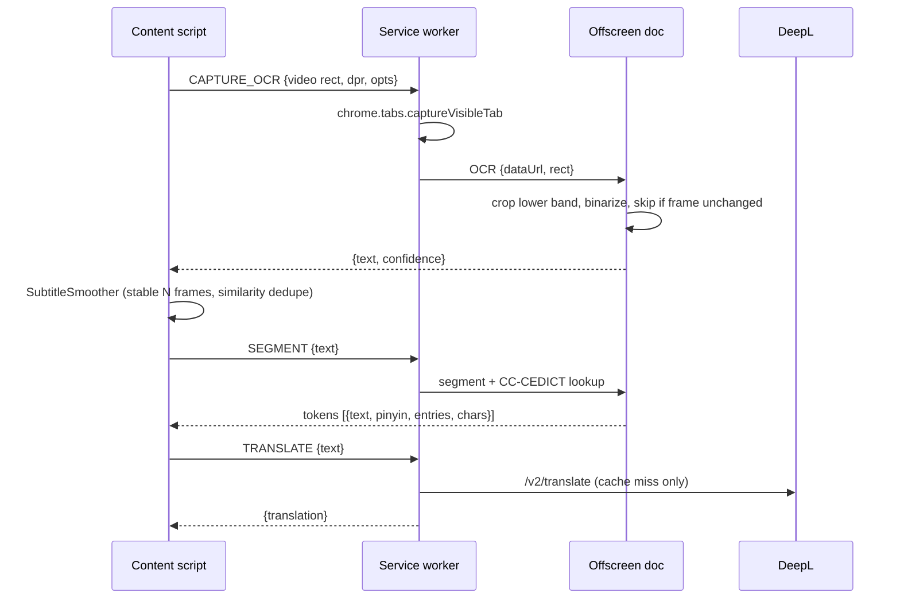

# Hanzi Subs Reactor

A Chrome extension (Manifest V3) that reads **burned-in Chinese subtitles** from any HTML5 `<video>` with OCR. It translates each line with a **local model** or **DeepL** and shows a Language Reactor-style interactive overlay: segmented words, Pinyin, and a hover dictionary (CC-CEDICT) with a breakdown of each character.

## Quick start

```bash
npm install
npm run setup          # Tesseract + PaddleOCR v4 (GPU) models, ONNX Runtime WebGPU, CC-CEDICT
# optional: npm run setup -- --model=best   (more accurate, larger and slower OCR models)
```

1. Open `chrome://extensions`, enable **Developer mode**, then click **Load unpacked** and select the `extension/` folder.
2. The options page opens. Pick a translator (see below) and click **Prepare model** or **Test translation**.
3. Play a video with hardcoded Chinese subtitles. Hover a word to see its dictionary card.

Requires Node 18 or later (for the built-in `fetch`).

## Translators

| Translator | Runs | Setup | Targets |
|---|---|---|---|
| **Chrome built-in** | On-device, Chrome's `Translator` API | Chrome 138+; click **Prepare model** once to download the language pack | Most languages |
| **Gemini Nano** (default) | On-device LLM, Chrome's Prompt API (`LanguageModel`) in the offscreen document | Chrome 138+, GPU with >4 GB VRAM or 16 GB RAM, ~22 GB free disk; click **Prepare model** once (~2 GB download). No key, no server. Until the model is ready (or on unsupported devices) lines fall back to Chrome built-in, uncached | Best in English, Spanish, Japanese |
| **Python local bridge** | Extension Paddle pre-crop + Qwen3-VL-2B single-pass transcription/translation, managed llama.cpp CUDA server | Prepare and run the companion app; select Python OCR and translator, paste its local token | English only |
| **DeepL** | Cloud API | API key (Free keys end in `:fx`) | DeepL languages |

Translations are cached in `chrome.storage.local` per translator and target language.
Opus-MT and local Ollama are no longer offered in Settings. Opening Settings with
either saved selection switches it to Gemini Nano and displays a notice.

Chrome built-in, Opus-MT and DeepL are machine translators and tend to be literal. The LLM translators (Gemini Nano, Ollama) follow a shared prompt (`shared/dialogue-prompt.js`) that asks for the speaker's intended meaning as natural dialogue.

Nano's session (instructions plus story background) is created as soon as a video is found and reused for every line. Right after each line is translated, a copy of it is given the dialogue context the next line will receive and processes it in the background, so when the next subtitle appears only that short line is left to process. Translations are shown whole, never streamed. If Nano answers in Chinese instead of translating, it is asked once more, then the line falls back to Chrome built-in (uncached). If it turns a Chinese statement into a question (no question mark, particle, question word or A-not-A form in the line), it is asked once more to keep it a statement. With *Keep the GPU ready during playback* (on by default), playback checks every 1 s and requests a one-token prompt after at least 0.25 s idle to reduce GPU idle gaps between subtitles; real translations abort it, and it stops when the video is paused or the tab is hidden. This uses extra power and may increase heat, but does not control GPU clocks or guarantee steady fan speed.

With subtitle context enabled, earlier dialogue of the same video helps disambiguate the current line. It comes from this episode's replay timeline, so it survives seeks and reloads. An episode is identified by the page URL and tab title: when a player switches episodes without reloading (new URL or only a new title), the dialogue context, story background, translation queue and the side panel history all start fresh (earlier episodes stay stored for replay). Gemini Nano and Ollama get up to eight earlier lines from the last three minutes; DeepL and Chrome get up to two lines from the last 15 seconds. The LLMs are instructed to translate intended meaning into natural dialogue rather than word for word, preserving tone, relationships, and terminology supported by the subtitles without inventing scene or plot details. Only the current line is returned. Prompt changes bump a cache version so older literal translations are not reused.

The translators receive text, not video images. Chrome uses preceding lines only when its output preserves line boundaries; DeepL has a dedicated context field. Neither supports the custom dialogue instructions used for the LLMs. Opus-MT translates individual lines without context. Model choice still affects translation quality. The logs show which translator produced each line (`Translate via …`).

**Story context (Gemini Nano / Ollama / Python Qwen, opt-in).** With *Use video background as story context* enabled, the extension reads the tab title (e.g. `全职法师第7季-02-免费在线观看-爱壹帆` → `全职法师`) and page description once per page, as soon as a video is found (typically before it starts) or when it is paused, and looks up a short matching Wikipedia summary (zh.wikipedia.org for Chinese titles, en.wikipedia.org otherwise; the cleaned title is sent to Wikipedia). The lookup runs in the background and never delays subtitles: lines translated before it arrives are not retranslated; later lines use it. The background is cached per page for the browser session and passed to the LLM as untrusted context for names, relationships and terminology. Scripts or transcripts are never fetched. This is a show-level summary when one exists, not an automatically generated recap of the current episode.

## Project structure

```
extension/                  <- load this folder unpacked
  manifest.json
  shared/defaults.js        default settings (shared by every context)
  shared/dialogue-prompt.js natural-dialogue prompt shared by the LLM translators (Gemini Nano, Ollama)
  background/
    service-worker.js       message router, captureVisibleTab, offscreen lifecycle
    translate.js            translator routing + chrome.storage.local cache, Ollama client
    story-context.js        video title/description + Wikipedia synopsis used as Ollama story context
    deepl.js                DeepL /v2/translate
  offscreen/
    offscreen.html/.js      long-lived document: OCR worker + dictionary in memory
    translator.js           on-device translation (Chrome Translator API, Opus-MT)
    ocr.js                  crop -> TextDetector / Prompt API, or preprocess -> PaddleOCR / Tesseract
    prompt-ocr.js           local Prompt API image OCR, capability checks and isolated frame sessions
    ocr-geometry.js         noise removal and text-dense subtitle line detection
    dictionary.js           CC-CEDICT index, token analysis, character breakdown
    segmenter.js            dictionary-driven DP word segmenter
    pinyin.js               numbered pinyin -> tone marks
  content/
    video-observer.js       finds the main <video>, tracks resize/fullscreen/aspect ratio
    subtitle-smoother.js    debounce / dedupe of OCR lines (Levenshtein similarity)
    overlay.js              Shadow-DOM subtitle overlay + dictionary card
    main.js                 capture loop, wiring, key bindings
  popup/                    quick toggles for the current site, opens the side panel
  sidepanel/                side panel: captured frame, OCR text, translation, history, Hanzi explorer
    sections/index.js       section registry – add { id, title, mount(container, ctx) } modules here
  options/                  DeepL key, OCR tuning, appearance, per-domain list
  vendor/   (generated)     tesseract.js, tesseract core wasm, traineddata, transformers.js + ORT wasm
  data/     (generated)     cedict.json (+ optional hsk.json)
scripts/setup.mjs           asset/dictionary build script
```

## Architecture



**Why `captureVisibleTab` instead of `canvas.drawImage(video)`?** Most video hosts serve frames from another origin, which taints the canvas so its pixels can't be read. A screenshot of the tab works on every site. The capture is cropped to the video's *content rect*, which accounts for `object-fit` letterboxing. Chrome limits this call to about 2 per second, so the minimum capture interval is 500 ms.

**Overlay vs. OCR region:** the overlay is placed above the OCR crop band by default, so it never ends up in the screenshot. Capturing pauses while the dictionary card is open.

**Moving subtitles / hiding burned-in ones:** drag the generated subtitles up or down on the video; the position is saved as a fraction of the video height (choosing a preset position in Options, or "Reset dragged position", undoes it). The *Blur subtitles already in the video* option (also in the toolbar popup as *Blur video subs*) adds a frosted band, e.g. over burned-in English subtitles; drag it to move it, drag its top/bottom edge to resize. With direct video-frame capture neither is seen by OCR; in tab-screenshot fallback mode keep them off the Chinese OCR band.

**OCR line detection:** text-dense rows are isolated before recognition so sparse background artwork does not stretch a subtitle's bounding box. The density threshold is relative to each row group's peak, allowing short subtitles as well as long lines.

Enhanced mode also uses a weaker stroke mask to expand existing line boxes within bounded dimensions. This preserves faint Chinese glyphs on light backgrounds beside stronger glyphs, without adding lines found only by the weak mask. PaddleOCR still recognizes the original colour pixels inside those boxes.

For bilingual subtitles, a further low-contrast fallback can recover an entirely missing centred row below an existing subtitle. Candidates must be nearby and of comparable height, with bounded width; recovered strokes also participate in frame-change detection. This is a geometry heuristic, not a guarantee of correct recognition.

OCR revision matching is restricted to one second and requires an ordered near-match or an expansion containing the previous text. Merely sharing characters or words does not merge separate dialogue lines. Native subtitle lines are not treated as OCR corrections.

Shorter OCR substrings of the currently recognized line are ignored (also on paused frames), even if their confidence is higher. Whitespace and punctuation are ignored for this check. Protection ends when the line clears or recognition resets; unrelated new dialogue still appears without additional stabilization delay.

**OCR translation settling:** translation waits 350 ms for corrections. If a previous translation is still displayed, new OCR text waits up to 500 ms before replacing it, or replaces it sooner together with its ready translation. Recognition and translation scheduling continue during that display hold; further reads do not extend its deadline. Without a displayed translation, OCR text appears immediately. A corrected read replaces its pending request; a distinct short line is retained for history rather than silently dropped. The newest line has translation priority. Native tracks, paused-frame OCR and cached replay lines do not wait. OCR confirmation of a known timeline entry keeps cached replay advancing. Duplicate requests for the same pending or active line are ignored. Corrections invalidate older translation results, and resets (such as seeking or changing episode) discard pending and queued work and ignore old in-flight responses.

**Ad detection:** on YouTube, OCR pauses only when the tracked video's player has an ad indicator (`ad-showing` / `ad-interrupting`), not just because playback stalls or a clip is short. Other sites retain heuristic detection; paused, seeking and buffering time does not count towards a playback stall.

Late translation results go to history only: the overlay accepts a result only for the current subtitle occurrence, before its known end time, or during its remaining 500 ms OCR reading hold while that same occurrence is still displayed. Identical text appearing again does not make an older result eligible for display. Info logs explain when a translation is history-only (ended, replaced/cleared, or overlay inactive).

Info-level `Displayed subtitle`, `Displayed translation` and `Displayed subtitle cleared` logs are emitted when the overlay writes or clears its text, including cached replay and delayed replacements. Rejected translation results do not produce display logs.

Info-level `Subtitle timing #<sequence>` logs correlate identification, translation dispatch/response and actual text/translation DOM display. Each snapshot includes ISO capture/OCR/identification/send/completion/display timestamps plus stage durations in milliseconds, with the originating frame ID and video time for OCR. Capture requests have a separate `Subtitle frame #<id>` log (screenshot mode timestamps the request, not the browser's exact screenshot instant). Native/replay lines have no new OCR capture timestamp; cached translations are marked and have no artificial send/completion time. Display timestamps measure DOM updates, not the subsequent browser paint.

**Fast dialogue:** distinct subtitles identified less than one second apart are shown together, with ` - ` between both Chinese lines and their available translations. Each new identification slides the one-second window forward and drops older entries; a correction replaces its original entry instead of adding another. Pending display holds preserve the identified group, and word lookups/pinyin still work across its members. History keeps each dialogue line separate. Translation results can update an older member only while it remains in the displayed group.

**Story title lookup:** bracketed show names such as `[The Best Day of My Life]` are kept for Wikipedia searches, while release tags such as `[ENG SUB]` and `[4K]` are ignored. If no article matches, translation still uses the page title and description.

The side panel's bottom **Story context** section (collapsed by default) shows the loaded title, description and Wikipedia synopsis, when available. It updates on episode changes and also loads the current context when the panel is opened later.

On YouTube, story context reads the full description embedded for the current video, rather than only the collapsed promotional preview. Membership/download links, hashtags and YOUKU's other-show recommendations are filtered out before retaining up to 1,800 characters of plot/cast details. Episode titles require a series-identified Wikipedia result and summary; a same-named film is not used. If no suitable article exists, the filtered page description is used without inventing a synopsis.

Run `npm test` for OCR geometry regression tests, including a binary text-mask fixture derived from a subtitle over detailed artwork.

## Settings (options page)

**Python local bridge (optional):** the companion project at `F:\GitHub\hanzi-to-subtitle-vlm`
provides a desktop status window and authenticated loopback OCR + Chinese-to-English
translation. Chrome retains video detection, the configured crop (including screenshot
fallback), dictionary, overlay and history. Before sending anything to Python, the extension reuses
its existing preprocessing and text-block detection (including faint-row recovery)
to reject bands without plausible subtitle blocks. Empty/background frames are
not PNG-encoded or sent to the bridge; they return empty OCR evidence to the
subtitle smoother so stale subtitles can clear. The presence filter uses the
selected preprocessing, color, outline and centre-filter settings. It is not
language recognition: an English-only text block can still reach Paddle.
For accepted frames, the extension first runs its existing Paddle recognizer on
the original-color candidate rows. An unchanged Chinese reading reuses the latest
successful Python result for that tab instead of sending another image, even on a
forced capture or when preceding dialogue changes. Embedded English, whitespace
and non-question/exclamation punctuation do not count as text changes. A longer
reading or any changed letter/digit is sent again; there is no fuzzy similarity
threshold that could hide a one-character correction. No local Chinese reading
means empty OCR evidence without sending a frame. Blank frames, tab resets, changed crop/settings or story
invalidate reuse. Only successful nonempty OCR/translation results are retained;
busy/error/empty responses remain retryable. Local Paddle loading/inference errors
are surfaced as OCR errors, not silently replaced by another engine.
A shorter contiguous fragment (at least two normalized characters) of the last
successful reading also reuses that complete result until blank evidence resets
the decision; new/added or substituted characters still trigger another call.
For Python crops, centered rows merge their horizontal bounds with overlapping
unrestricted detections to retain split/faint ends without admitting unrelated rows.
The extension selects Chinese rows from those same Paddle readings and crops with
safety margins (two row heights horizontally, half a row vertically, clipped before
neighboring rows). It trims near-black padding, excludes English rows and unused
width, and stacks Chinese rows without rescaling or duplicating overlapping padding.
Only that original-color crop is sent, with raw Paddle text in a separate
UTF-8/base64 diagnostic header (4000-character maximum). Python no longer loads or
runs Paddle in default mode; it applies a light luminance sharpening pass before
the VLM (changes capped at 12/255, no binarization or morphology);
the extension's stronger detection mask is never sent as recognition input.
Qwen3-VL-2B then reads the lightly enhanced color pixels and translates
them with context in **one call**. Paddle text is displayed/logged by Python only,
never added to the VLM prompt or substituted for the final transcription.
Automatic selection can still miss a row; the
padding reduces clipping but cannot guarantee recognition. VLM confidence and
character boxes are unavailable; minimum confidence does not apply.
Centre filtering applies to the extension's row detection.
Color and outline tuning guide pre-cropping. Debug shows green source
regions and actual VLM input dimensions. Select **Python local bridge** for both
OCR engine and Translator, copy the app's token into Settings, and click
**Test Python connection**. The default endpoint is `http://127.0.0.1:8765`;
only loopback HTTP is allowed. The token is stored locally, not in Chrome Sync.
Python returns OCR and translation together; the translation is reused when the
existing subtitle scheduler asks for it. The exact bundled translation travels
with its matching OCR text through subtitle stabilization and is applied directly
to the overlay/history; evolving dialogue context cannot cause a second
`/translate` request for that result. Other translators still use their own path.
When Python OCR has already returned a nonempty translation and Python
is the selected translator, the 350 ms OCR translation-settling wait is bypassed.
Subtitle stabilization, correction handling and stale-result checks still apply;
other OCR/translator combinations retain their existing settling behavior.
Native-track text can also use the Python
translator. English targets only; Tesseract dictionary glyph correction does not
apply. Native text uses the same loaded Qwen3-VL-2B in text-only mode.
It receives the same shared dialogue instructions, up to eight earlier subtitle
lines from this episode's last three minutes, and the optional title, description
and Wikipedia synopsis used by Gemini Nano. Names and spellings included in that
background are available to the model; it does not invent an episode recap or a
character list. Enable **Use earlier dialogue** and **Use video background as story
context** in Translation settings. Both OCR+translation and native-track requests
carry the context; cache identities include the background, preceding lines and
instructions, so a text-only OPUS result cannot override Qwen. Python history
translations are re-evaluated after a page reload rather than importing older
context-free results. If another translator is selected it still runs
normally, rather than displaying Python's English translation. No silent fallback
occurs if the app is unavailable. Python permits one OCR request in flight per
content context; saturated ticks are skipped before capture rather than queuing
old frames. Server-wide busy responses skip a frame. Debug logs show server and
round-trip timing. The companion uses Qwen3-VL-2B Q4_K_M with a 230-token visual
budget (approximately 20% above the previous 192) and an English JSON grammar
that excludes Han characters, without replacing names after generation. It
puts all instructions/dialogue before the image for prefix-cache reuse.
On the tested RTX 2070, changing synthetic Qwen3 subtitles took roughly 282-325 ms
after the first prefix evaluation (436 ms); changed frames with prefix caching
disabled took 359-379 ms. These exclude Chrome Paddle/cropping, capture and display.
**Sub-500 ms is not guaranteed**. The visual budget can lose
detail on untested long/faint lines. Contextual text-only
translation is much faster. Restart Python after downloading the vision weights
and projector with `--prepare`.

Python-mode direct video capture checks every 100 ms (higher CPU/GPU use), still
with one request in flight and unchanged-frame skipping. Screenshot fallback keeps
its >=500 ms rate limit; other OCR engines retain their configured interval.
Info-level `Python latency summary` logs report rolling means and p95 over the
last 30 displayed translations: capture-to-display, capture-to-OCR, Python geometry,
OCR, translation, total server processing and bridge round trip. Replay without a
new frame is excluded; samples reset with subtitle state. Capture-to-display starts
at frame acquisition, not the unknown instant subtitles first appear in the video.
In single-pass mode, Python geometry covers decoding/light preprocessing (Paddle
cropping now runs in Chrome), OCR includes both VLM
transcription and translation, and the separate translation stage is zero.

The Python HTTP hop sends binary PNG/JPEG crops rather than JSON/base64 images
(extension-internal messages still use data URLs). Restart the updated Python app
as well as reloading Chrome; connection testing checks binary-transfer and
context-aware Qwen support. UTF-8 context travels in a base64 header alongside
the binary image (up to eight 500-character lines and 4000 background characters).
Python caches up to 32 exact received-crop results, keyed also by the
story, preceding dialogue and instructions. Changed pixels or context invalidate
the result cache. Debug output identifies single-pass VLM mode. The companion retains
`--ocr-engine paddle` as an explicit legacy mode; only that mode uses detected-line
crops, faint-stroke geometry recovery and confidence filtering.

Chrome native OCR (`TextDetector`) is no longer offered in Settings. Opening
Settings with that saved selection switches it to PaddleOCR and displays a notice.

**Chrome Prompt API image OCR (Gemma/Nano, experimental):** this is a separate OCR engine, not `TextDetector`. Select it under OCR engine and click **Download OCR model** in Settings to check image input support and, if needed, download the model with a user gesture. Use the image test buttons below to test real inference. Translation's **Prepare model** button is separate. Chrome selects the actual local model; installing `gemma4_component`, Nano or an Optimization Guide manifest does not prove image OCR is available. Prompt API/image-input flags may be required depending on Chrome version; restart after changing flags. Missing support, unprepared models and failed recognition produce explicit errors, with no silent fallback to another OCR engine.

For live Prompt API OCR, Paddle selects Chinese rows, crops their original-color
pixels and suppresses repeated subtitles using the same gate as the Python path.
Chrome reads that crop and returns Chinese plus English in one call, with output
languages undeclared. Choose **Gemini Nano** as translator to use the bundled
English directly; other selected translators still translate the returned Chinese.
Dictionary, pinyin and history use Chrome's Chinese transcription. Local Paddle
assets are required. Each frame clones a reusable base session and releases the
clone. Paddle recognition uses the configured enhancement (or binary threshold);
the vision model still receives the original-color crop. Only Python bridge mode
bypasses browser enhancement before Paddle.
This keeps prior images and answers out of the next frame. Episode background
and dialogue are context only. No Python, API key or cloud inference is used.
The model can still misread or hallucinate; confidence scores are unavailable.
**PaddleOCR primary + Chrome vision fallback** instead uses Paddle text for normal
rows and the selected text translator (Nano recommended).
With Nano selected, accepted Paddle text is sent for translation immediately,
without the usual 350 ms OCR settling wait. The previous translated subtitle can
still remain visible for up to 500 ms while the next translation is prepared;
it is replaced as soon as the new translation arrives. OCR corrections supersede
older translation results, though an already-running request must finish first.
The overlay groups distinct rapid dialogue within a one-second window; repeated
text (including punctuation-only changes) replaces its earlier copy instead of
duplicating the subtitle and translation.
The side panel's **Captured frame** section adds a third preview of the exact
original-color stacked crop. Green PASS marks accepted Paddle rows; red FALLBACK
marks Paddle rejection routed to vision, and red REJECTED marks frames with no
usable crop. Labels also identify reused results (the preview is the current crop,
not a claim that inference reran). Empty/rejected frames clear the final preview.
The first two previews remain the source band and detection overlay.
Below the final crop, the panel shows Paddle's confidence (lowest selected row)
and a separate cleaned-input preview shows enhanced Chinese rows cropped to
their detected bounds without added margins, stacked before model
resizing. Rejected frames with no selected rows clear this preview.
Chrome Paddle receives these tight row bounds; safety margins remain only on
the original-color vision crop. Python bridge Paddle input is unchanged.
Optional outline enhancement adds at most 10% to the stroke map; a dark shadow
is not required and unoutlined strokes are never penalized by that boost.
Python bridge mode does not show a cleaned
preview because it bypasses browser enhancement.
The recognition details also include its raw reading, the final OCR engine's Chinese output, and bundled English when
available. Vision confidence is not fabricated; unavailable scores are labelled.
This mode uses
Chrome vision
only when a Chinese row has average confidence below 80% (or the configured
minimum, if higher), any glyph below 50%, or a luminance 10th-to-90th percentile
range below 32/255. Empty unreliable rows may also trigger vision. Vision replaces
both Chinese and English on fallback; reliable rows avoid image inference.
These are heuristics, not proof of white-on-white or black-on-black contamination:
Empty Paddle readings require at least two separated glyph-sized column runs
before vision fallback. Broad artwork or scattered noise is rejected instead of
being sent to vision. This conservative gate can also miss heavily merged or
single-character subtitles when Paddle reads nothing.
confident mistakes and completely undetected rows can still be missed. Repeated
Paddle readings reuse results until a blank/reset or changed reading/settings.
Chrome vision limits context to the last two dialogue lines (200 characters each)
and the first 800 characters of video background, reducing repeated prompt work.
This can lose names/details later in a synopsis; Python and text-only translators
retain their existing context limits.
Chrome vision failures report the failing stage, native error, raw model response,
elapsed time, crop dimensions, source-band dimensions and preliminary Paddle text.
Context diagnostics include counts only, not the full synopsis or earlier dialogue.

**Inspect Prompt API capabilities** queries Chrome without creating sessions or
starting downloads. The selectable report shows browser/API information, exact
options and raw availability for default text, English/Chinese input and output,
image input with English or Chinese output, and the actual OCR configuration.
Native exception names/messages and sampling parameters are retained, so an
unsupported Chinese declaration can be distinguished from image-input support.
Availability alone does not establish OCR accuracy. Chrome may expose additional
internal model diagnostics at `chrome://on-device-internals`.

**Test image → English** performs real inference using image input and English
output declarations only, independently of Chinese-output OCR availability. It
sends a generated Chinese image (not its text or expected answer in the prompt),
shows the raw model response, expected meaning and elapsed time, and releases the
session. It does not download models or change the selected OCR engine.

**Test image → Chinese + English** uses the same sample but leaves output
languages undeclared and requests Chinese transcription plus English translation
as JSON. It checks Chinese against the sample and displays the raw response for
English accuracy review. Plain JSON and JSON wrapped in a Markdown code fence are
accepted; extra commentary and malformed JSON remain errors.
Single-item arrays wrapping the bilingual object are also accepted. Live vision
requests constrain output to one object with exactly two string fields;
multi-item arrays are not silently merged or truncated.
Live vision explicitly requests pinyin/established English character names and
constrains the English field to exclude common Han character ranges. Runtime
validation still rejects mixed-Chinese English rather than displaying it.
This experimental test does not change live OCR routing.

| Group | Settings |
|---|---|
| Translation | translator (Gemini Nano / Python local bridge / Chrome / DeepL), target language, DeepL key + plan, story context, cache clear |
| OCR | language (`chi_sim`, `chi_tra`, both), capture interval, crop band (top/bottom %), brightness threshold, subtitle color, min confidence, stable frames |
| Appearance | font sizes, position (above OCR band / top / below video, or dragged), show pinyin / translation, blur band for burned-in subtitles (strength, width) |
| Behaviour | hover vs. click, pause on hover, key bindings |
| Sites | global enable, disabled domains list |

Default keys: `Alt+Shift+S` toggles the overlay, `Alt+Shift+T` toggles the translation, and `Alt+Shift+P` toggles Pinyin.

## HSK levels (optional)

Put `extension/data/hsk.json` in place as `{ "爱": 1, "爱好": 2, ... }` (simplified word → level). It is loaded automatically if present.

## Known limitations

- **DRM video** (Netflix, Disney+, etc.) often appears black in tab captures, so OCR sees nothing. These services usually provide text subtitle tracks anyway.
- Only top-level frames are supported. Videos inside cross-origin iframes are not tracked yet.
- If a site puts the `<video>` element itself into fullscreen (rather than its container), the overlay can't be shown on top of it.
- OCR accuracy depends on subtitle contrast. Adjust the crop band, threshold, and color in the options.

## Roadmap

- [ ] iframe support (frame offset resolution)
- [ ] Optional `jieba-wasm` segmenter
- [ ] Saved words / export to Anki
- [ ] Subtitle history sidebar with replay of the previous line
- [ ] Move the dictionary into IndexedDB to make offscreen startup faster
