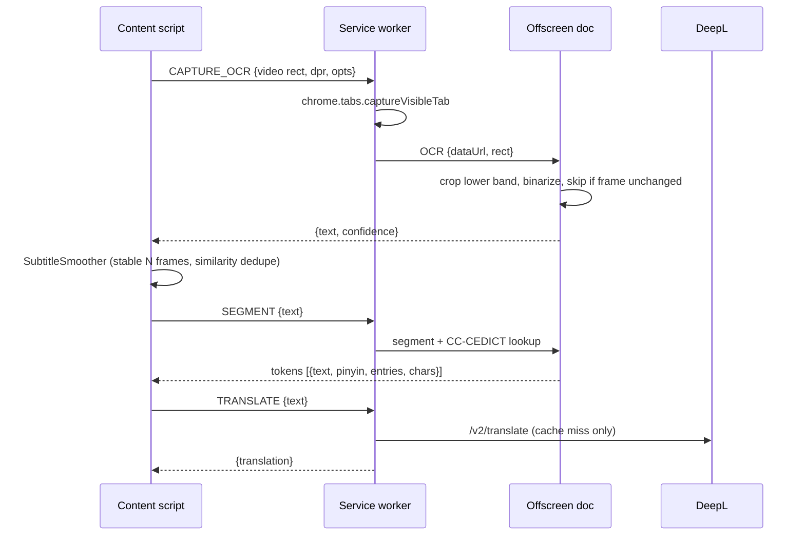

# Hanzi Subs Reactor

A Chrome extension (Manifest V3) that reads **burned-in Chinese subtitles** from any HTML5 `<video>` with OCR. It translates each line with a **local model** or **DeepL** and shows a Language Reactor-style interactive overlay: segmented words, Pinyin, and a hover dictionary (CC-CEDICT) with a breakdown of each character.

## Quick start

```bash
npm install
npm run setup          # Tesseract + PaddleOCR v4 (GPU) models, ONNX Runtime WebGPU, CC-CEDICT
# optional: npm run setup -- --model=best   (more accurate, larger and slower OCR models)
```

1. Open `chrome://extensions`, enable **Developer mode**, then click **Load unpacked** and select the `extension/` folder.
2. The options page opens. Pick a translator (see below) and click **Prepare model** or **Test translation**.
3. Play a video with hardcoded Chinese subtitles. Hover a word to see its dictionary card.

Requires Node 18 or later (for the built-in `fetch`).

## Translators

| Translator | Runs | Setup | Targets |
|---|---|---|---|
| **Chrome built-in** (default) | On-device, Chrome's `Translator` API | Chrome 138+; click **Prepare model** once to download the language pack | Most languages |
| **Opus-MT** | On-device, Transformers.js + ONNX (WASM) in the offscreen document | Model (~100 MB) downloads from Hugging Face on first use, then is cached | English only |
| **Ollama** | Local LLM server | Install Ollama, `ollama pull qwen2.5:7b`, start it with `OLLAMA_ORIGINS=chrome-extension://*` | Any |
| **DeepL** | Cloud API | API key (Free keys end in `:fx`) | DeepL languages |

Translations are cached in `chrome.storage.local` per translator and target language.

## Project structure

```
extension/                  <- load this folder unpacked
  manifest.json
  shared/defaults.js        default settings (shared by every context)
  background/
    service-worker.js       message router, captureVisibleTab, offscreen lifecycle
    translate.js            translator routing + chrome.storage.local cache, Ollama client
    deepl.js                DeepL /v2/translate
  offscreen/
    offscreen.html/.js      long-lived document: OCR worker + dictionary in memory
    translator.js           on-device translation (Chrome Translator API, Opus-MT)
    ocr.js                  crop -> binarize -> change detection -> Tesseract
    dictionary.js           CC-CEDICT index, token analysis, character breakdown
    segmenter.js            dictionary-driven DP word segmenter
    pinyin.js               numbered pinyin -> tone marks
  content/
    video-observer.js       finds the main <video>, tracks resize/fullscreen/aspect ratio
    subtitle-smoother.js    debounce / dedupe of OCR lines (Levenshtein similarity)
    overlay.js              Shadow-DOM subtitle overlay + dictionary card
    main.js                 capture loop, wiring, key bindings
  popup/                    quick toggles for the current site, opens the side panel
  sidepanel/                side panel: captured frame, OCR text, translation, history, Hanzi explorer
    sections/index.js       section registry – add { id, title, mount(container, ctx) } modules here
  options/                  DeepL key, OCR tuning, appearance, per-domain list
  vendor/   (generated)     tesseract.js, tesseract core wasm, traineddata, transformers.js + ORT wasm
  data/     (generated)     cedict.json (+ optional hsk.json)
scripts/setup.mjs           asset/dictionary build script
```

## Architecture



**Why `captureVisibleTab` instead of `canvas.drawImage(video)`?** Most video hosts serve frames from another origin, which taints the canvas so its pixels can't be read. A screenshot of the tab works on every site. The capture is cropped to the video's *content rect*, which accounts for `object-fit` letterboxing. Chrome limits this call to about 2 per second, so the minimum capture interval is 500 ms.

**Overlay vs. OCR region:** the overlay is placed above the OCR crop band by default, so it never ends up in the screenshot. Capturing pauses while the dictionary card is open.

## Settings (options page)

| Group | Settings |
|---|---|
| Translation | translator (Chrome / Opus-MT / Ollama / DeepL), target language, DeepL key + plan, Ollama URL + model, cache clear |
| OCR | language (`chi_sim`, `chi_tra`, both), capture interval, crop band (top/bottom %), brightness threshold, subtitle color, min confidence, stable frames |
| Appearance | font sizes, position (above OCR band / top / below video), show pinyin / translation |
| Behaviour | hover vs. click, pause on hover, key bindings |
| Sites | global enable, disabled domains list |

Default keys: `Alt+Shift+S` toggles the overlay, `Alt+Shift+T` toggles the translation, and `Alt+Shift+P` toggles Pinyin.

## HSK levels (optional)

Put `extension/data/hsk.json` in place as `{ "爱": 1, "爱好": 2, ... }` (simplified word → level). It is loaded automatically if present.

## Known limitations

- **DRM video** (Netflix, Disney+, etc.) often appears black in tab captures, so OCR sees nothing. These services usually provide text subtitle tracks anyway.
- Only top-level frames are supported. Videos inside cross-origin iframes are not tracked yet.
- If a site puts the `<video>` element itself into fullscreen (rather than its container), the overlay can't be shown on top of it.
- OCR accuracy depends on subtitle contrast. Adjust the crop band, threshold, and color in the options.

## Roadmap

- [ ] iframe support (frame offset resolution)
- [ ] Optional `jieba-wasm` segmenter
- [ ] Saved words / export to Anki
- [ ] Subtitle history sidebar with replay of the previous line
- [ ] Move the dictionary into IndexedDB to make offscreen startup faster
