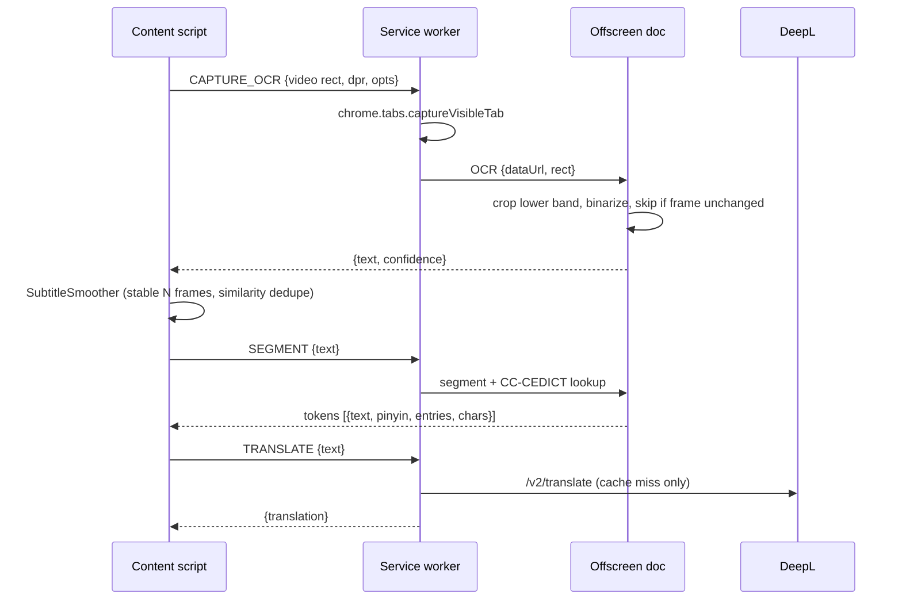

# Hanzi Subs Reactor

A Chrome extension (Manifest V3) that reads **burned-in Chinese subtitles** from any HTML5 `<video>` with OCR. It translates each line with a **local model** or **DeepL** and shows a Language Reactor-style interactive overlay: segmented words, Pinyin, and a hover dictionary (CC-CEDICT) with a breakdown of each character.

## Quick start

```bash
npm install
npm run setup          # Tesseract + PaddleOCR v4 (GPU) models, ONNX Runtime WebGPU, CC-CEDICT
# optional: npm run setup -- --model=best   (more accurate, larger and slower OCR models)
```

1. Open `chrome://extensions`, enable **Developer mode**, then click **Load unpacked** and select the `extension/` folder.
2. The options page opens. Pick a translator (see below) and click **Prepare model** or **Test translation**.
3. Play a video with hardcoded Chinese subtitles. Hover a word to see its dictionary card.

Requires Node 18 or later (for the built-in `fetch`).

## Translators

| Translator | Runs | Setup | Targets |
|---|---|---|---|
| **Chrome built-in** | On-device, Chrome's `Translator` API | Chrome 138+; click **Prepare model** once to download the language pack | Most languages |
| **Gemini Nano** (default) | On-device LLM, Chrome's Prompt API (`LanguageModel`) in the offscreen document | Chrome 138+, GPU with >4 GB VRAM or 16 GB RAM, ~22 GB free disk; click **Prepare model** once (~2 GB download). No key, no server. Until the model is ready (or on unsupported devices) lines fall back to Chrome built-in, uncached | Best in English, Spanish, Japanese |
| **Opus-MT** | On-device, Transformers.js + ONNX (WASM) in the offscreen document | Model (~100 MB) downloads from Hugging Face on first use, then is cached | English only |
| **Ollama** | Local LLM server | Install Ollama, `ollama pull qwen2.5:7b`, start it with `OLLAMA_ORIGINS=chrome-extension://*` | Any |
| **DeepL** | Cloud API | API key (Free keys end in `:fx`) | DeepL languages |

Translations are cached in `chrome.storage.local` per translator and target language.

Chrome built-in, Opus-MT and DeepL are machine translators and tend to be literal. The LLM translators (Gemini Nano, Ollama) follow a shared prompt (`shared/dialogue-prompt.js`) that asks for the speaker's intended meaning as natural dialogue.

Nano's session (instructions plus story background) is created as soon as a video is found and reused for every line. Right after each line is translated, a copy of it is given the dialogue context the next line will receive and processes it in the background, so when the next subtitle appears only that short line is left to process. Translations are shown whole, never streamed. If Nano answers in Chinese instead of translating, it is asked once more, then the line falls back to Chrome built-in (uncached). If it turns a Chinese statement into a question (no question mark, particle, question word or A-not-A form in the line), it is asked once more to keep it a statement. With *Keep the GPU ready during playback* (on by default), playback checks every 1 s and requests a one-token prompt after at least 0.25 s idle to reduce GPU idle gaps between subtitles; real translations abort it, and it stops when the video is paused or the tab is hidden. This uses extra power and may increase heat, but does not control GPU clocks or guarantee steady fan speed.

With subtitle context enabled, earlier dialogue of the same video helps disambiguate the current line. It comes from this episode's replay timeline, so it survives seeks and reloads. An episode is identified by the page URL and tab title: when a player switches episodes without reloading (new URL or only a new title), the dialogue context, story background, translation queue and the side panel history all start fresh (earlier episodes stay stored for replay). Gemini Nano and Ollama get up to eight earlier lines from the last three minutes; DeepL and Chrome get up to two lines from the last 15 seconds. The LLMs are instructed to translate intended meaning into natural dialogue rather than word for word, preserving tone, relationships, and terminology supported by the subtitles without inventing scene or plot details. Only the current line is returned. Prompt changes bump a cache version so older literal translations are not reused.

The translators receive text, not video images. Chrome uses preceding lines only when its output preserves line boundaries; DeepL has a dedicated context field. Neither supports the custom dialogue instructions used for the LLMs. Opus-MT translates individual lines without context. Model choice still affects translation quality. The logs show which translator produced each line (`Translate via …`).

**Story context (Gemini Nano / Ollama, opt-in).** With *Use video background as story context* enabled, the extension reads the tab title (e.g. `全职法师第7季-02-免费在线观看-爱壹帆` → `全职法师`) and page description once per page, as soon as a video is found (typically before it starts) or when it is paused, and looks up a short matching Wikipedia summary (zh.wikipedia.org for Chinese titles, en.wikipedia.org otherwise; the cleaned title is sent to Wikipedia). The lookup runs in the background and never delays subtitles: lines translated before it arrives are not retranslated; later lines use it. The background is cached per page for the browser session and passed to the LLM as untrusted context for names, relationships and terminology. Scripts or transcripts are never fetched.

## Project structure

```
extension/                  <- load this folder unpacked
  manifest.json
  shared/defaults.js        default settings (shared by every context)
  shared/dialogue-prompt.js natural-dialogue prompt shared by the LLM translators (Gemini Nano, Ollama)
  background/
    service-worker.js       message router, captureVisibleTab, offscreen lifecycle
    translate.js            translator routing + chrome.storage.local cache, Ollama client
    story-context.js        video title/description + Wikipedia synopsis used as Ollama story context
    deepl.js                DeepL /v2/translate
  offscreen/
    offscreen.html/.js      long-lived document: OCR worker + dictionary in memory
    translator.js           on-device translation (Chrome Translator API, Opus-MT)
    ocr.js                  crop -> preprocess -> change detection -> PaddleOCR / Tesseract
    ocr-geometry.js         noise removal and text-dense subtitle line detection
    dictionary.js           CC-CEDICT index, token analysis, character breakdown
    segmenter.js            dictionary-driven DP word segmenter
    pinyin.js               numbered pinyin -> tone marks
  content/
    video-observer.js       finds the main <video>, tracks resize/fullscreen/aspect ratio
    subtitle-smoother.js    debounce / dedupe of OCR lines (Levenshtein similarity)
    overlay.js              Shadow-DOM subtitle overlay + dictionary card
    main.js                 capture loop, wiring, key bindings
  popup/                    quick toggles for the current site, opens the side panel
  sidepanel/                side panel: captured frame, OCR text, translation, history, Hanzi explorer
    sections/index.js       section registry – add { id, title, mount(container, ctx) } modules here
  options/                  DeepL key, OCR tuning, appearance, per-domain list
  vendor/   (generated)     tesseract.js, tesseract core wasm, traineddata, transformers.js + ORT wasm
  data/     (generated)     cedict.json (+ optional hsk.json)
scripts/setup.mjs           asset/dictionary build script
```

## Architecture



**Why `captureVisibleTab` instead of `canvas.drawImage(video)`?** Most video hosts serve frames from another origin, which taints the canvas so its pixels can't be read. A screenshot of the tab works on every site. The capture is cropped to the video's *content rect*, which accounts for `object-fit` letterboxing. Chrome limits this call to about 2 per second, so the minimum capture interval is 500 ms.

**Overlay vs. OCR region:** the overlay is placed above the OCR crop band by default, so it never ends up in the screenshot. Capturing pauses while the dictionary card is open.

**Moving subtitles / hiding burned-in ones:** drag the generated subtitles up or down on the video; the position is saved as a fraction of the video height (choosing a preset position in Options, or "Reset dragged position", undoes it). The *Blur subtitles already in the video* option (also in the toolbar popup as *Blur video subs*) adds a frosted band, e.g. over burned-in English subtitles; drag it to move it, drag its top/bottom edge to resize. With direct video-frame capture neither is seen by OCR; in tab-screenshot fallback mode keep them off the Chinese OCR band.

**OCR line detection:** text-dense rows are isolated before recognition so sparse background artwork does not stretch a subtitle's bounding box. The density threshold is relative to each row group's peak, allowing short subtitles as well as long lines.

Enhanced mode also uses a weaker stroke mask to expand existing line boxes within bounded dimensions. This preserves faint Chinese glyphs on light backgrounds beside stronger glyphs, without adding lines found only by the weak mask. PaddleOCR still recognizes the original colour pixels inside those boxes.

For bilingual subtitles, a further low-contrast fallback can recover an entirely missing centred row below an existing subtitle. Candidates must be nearby and of comparable height, with bounded width; recovered strokes also participate in frame-change detection. This is a geometry heuristic, not a guarantee of correct recognition.

OCR revision matching is restricted to one second and requires an ordered near-match or an expansion containing the previous text. Merely sharing characters or words does not merge separate dialogue lines. Native subtitle lines are not treated as OCR corrections.

Shorter OCR substrings of the currently recognized line are ignored (also on paused frames), even if their confidence is higher. Whitespace and punctuation are ignored for this check. Protection ends when the line clears or recognition resets; unrelated new dialogue still appears without additional stabilization delay.

**OCR translation settling:** translation waits 350 ms for corrections. If a previous translation is still displayed, new OCR text waits up to 500 ms before replacing it, or replaces it sooner together with its ready translation. Recognition and translation scheduling continue during that display hold; further reads do not extend its deadline. Without a displayed translation, OCR text appears immediately. A corrected read replaces its pending request; a distinct short line is retained for history rather than silently dropped. The newest line has translation priority. Native tracks, paused-frame OCR and cached replay lines do not wait. OCR confirmation of a known timeline entry keeps cached replay advancing. Duplicate requests for the same pending or active line are ignored. Corrections invalidate older translation results, and resets (such as seeking or changing episode) discard pending and queued work and ignore old in-flight responses.

**Ad detection:** on YouTube, OCR pauses only when the tracked video's player has an ad indicator (`ad-showing` / `ad-interrupting`), not just because playback stalls or a clip is short. Other sites retain heuristic detection; paused, seeking and buffering time does not count towards a playback stall.

Late translation results go to history only: the overlay accepts a result only for the current subtitle occurrence, before its known end time, or during its remaining 500 ms OCR reading hold while that same occurrence is still displayed. Identical text appearing again does not make an older result eligible for display. Info logs explain when a translation is history-only (ended, replaced/cleared, or overlay inactive).

Info-level `Displayed subtitle`, `Displayed translation` and `Displayed subtitle cleared` logs are emitted when the overlay writes or clears its text, including cached replay and delayed replacements. Rejected translation results do not produce display logs.

Info-level `Subtitle timing #<sequence>` logs correlate identification, translation dispatch/response and actual text/translation DOM display. Each snapshot includes ISO capture/OCR/identification/send/completion/display timestamps plus stage durations in milliseconds, with the originating frame ID and video time for OCR. Capture requests have a separate `Subtitle frame #<id>` log (screenshot mode timestamps the request, not the browser's exact screenshot instant). Native/replay lines have no new OCR capture timestamp; cached translations are marked and have no artificial send/completion time. Display timestamps measure DOM updates, not the subsequent browser paint.

**Fast dialogue:** distinct subtitles identified less than one second apart are shown together, with ` - ` between both Chinese lines and their available translations. Each new identification slides the one-second window forward and drops older entries; a correction replaces its original entry instead of adding another. Pending display holds preserve the identified group, and word lookups/pinyin still work across its members. History keeps each dialogue line separate. Translation results can update an older member only while it remains in the displayed group.

**Story title lookup:** bracketed show names such as `[The Best Day of My Life]` are kept for Wikipedia searches, while release tags such as `[ENG SUB]` and `[4K]` are ignored. If no article matches, translation still uses the page title and description.

The side panel's bottom **Story context** section (collapsed by default) shows the loaded title, description and Wikipedia synopsis, when available. It updates on episode changes and also loads the current context when the panel is opened later.

On YouTube, story context reads the full description embedded for the current video, rather than only the collapsed promotional preview. Membership/download links, hashtags and YOUKU's other-show recommendations are filtered out before retaining up to 1,800 characters of plot/cast details. Episode titles require a series-identified Wikipedia result and summary; a same-named film is not used. If no suitable article exists, the filtered page description is used without inventing a synopsis.

Run `npm test` for OCR geometry regression tests, including a binary text-mask fixture derived from a subtitle over detailed artwork.

## Settings (options page)

| Group | Settings |
|---|---|
| Translation | translator (Chrome / Opus-MT / Ollama / DeepL), target language, DeepL key + plan, Ollama URL + model, story context, cache clear |
| OCR | language (`chi_sim`, `chi_tra`, both), capture interval, crop band (top/bottom %), brightness threshold, subtitle color, min confidence, stable frames |
| Appearance | font sizes, position (above OCR band / top / below video, or dragged), show pinyin / translation, blur band for burned-in subtitles (strength, width) |
| Behaviour | hover vs. click, pause on hover, key bindings |
| Sites | global enable, disabled domains list |

Default keys: `Alt+Shift+S` toggles the overlay, `Alt+Shift+T` toggles the translation, and `Alt+Shift+P` toggles Pinyin.

## HSK levels (optional)

Put `extension/data/hsk.json` in place as `{ "爱": 1, "爱好": 2, ... }` (simplified word → level). It is loaded automatically if present.

## Known limitations

- **DRM video** (Netflix, Disney+, etc.) often appears black in tab captures, so OCR sees nothing. These services usually provide text subtitle tracks anyway.
- Only top-level frames are supported. Videos inside cross-origin iframes are not tracked yet.
- If a site puts the `<video>` element itself into fullscreen (rather than its container), the overlay can't be shown on top of it.
- OCR accuracy depends on subtitle contrast. Adjust the crop band, threshold, and color in the options.

## Roadmap

- [ ] iframe support (frame offset resolution)
- [ ] Optional `jieba-wasm` segmenter
- [ ] Saved words / export to Anki
- [ ] Subtitle history sidebar with replay of the previous line
- [ ] Move the dictionary into IndexedDB to make offscreen startup faster
